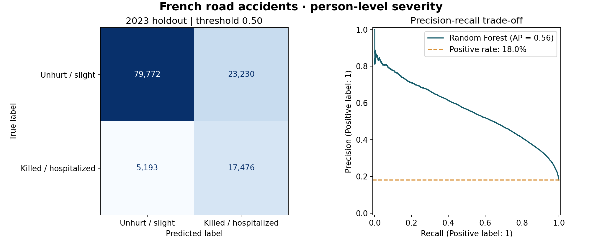
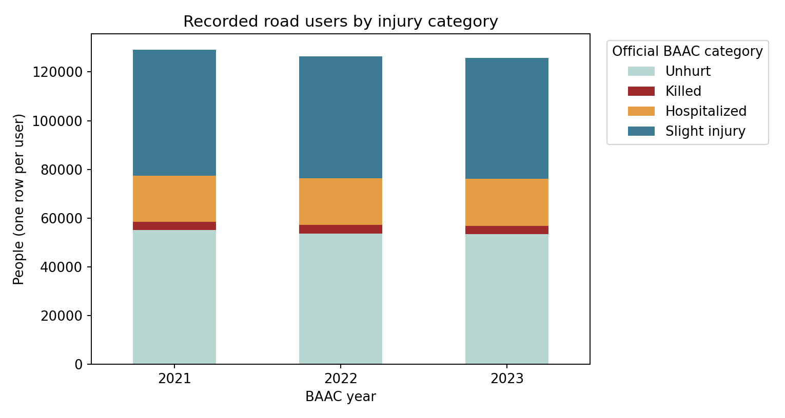

# French Road Accident Severity · Machine Learning


**From four annual open-data tables to a reproducible injury-severity benchmark, evaluated on a future year.**

A CY Tech group project by **Naoufal Berquecha, Aymane Outimjicht and Ikbal El Khalidi**, combining data integration, classification and model interpretation. This repository includes a corrected executable benchmark alongside the original Random Forest, Optuna and SHAP research.

**En français :** analyse de la gravité des blessures des usagers impliqués dans les accidents routiers enregistrés en France. Le dépôt présente un pipeline Python reproductible, une évaluation chronologique et les travaux académiques d'origine avec leurs limites documentées.

[Results](#results) · [Run locally](#run-locally) · [Methodology](docs/methodology.md) · [Data guide](data/README.md) · [Original research](research/README.md)



## What this project demonstrates

- **Data engineering:** integrate characteristics, locations, vehicles and users across three annual schemas, with checked join cardinality and source hashes.
- **Data quality:** preserve one row per person, resolve ambiguous road attributes, parse times and validate the official target coding.
- **Machine learning:** nominal feature encoding, training-only imputation, class-weighted Random Forest and a simple reference baseline.
- **Evaluation:** train on 2021-2022; evaluate once on 2023, keeping accidents out of both partitions simultaneously.
- **Research transparency:** preserve original Optuna and SHAP work, while distinguishing historical findings from freshly executed results.

## Scope

The target is **killed or hospitalized (`grav` 2 or 3)** versus **unhurt or slightly injured (`grav` 1 or 4)**, at the **road-user level**. Unknown labels are excluded.

BAAC contains recorded injury accidents, not all journeys. Several predictors describe events recorded after a collision. The task is therefore retrospective injury-severity classification; the model does not estimate a driver's probability of having an accident.

## Results

Executed on the complete supplied snapshot: **381,280 labelled road users**, comprising **255,609 training rows** and **125,671 test rows**. The held-out positive rate is **18.04%**. All preprocessing is fitted on training data; the classification threshold is fixed at 0.50.

| Metric · 2023 test | Majority / prior baseline | Random Forest |
|---|---:|---:|
| ROC-AUC | 0.5000 | **0.8533** |
| Average precision | 0.1804 | **0.5620** |
| Balanced accuracy | 50.00% | **77.27%** |
| Positive-class precision | 0.00% | **42.93%** |
| Positive-class recall | 0.00% | **77.09%** |
| Positive-class F1 | 0.0000 | **0.5515** |
| Accuracy | **81.96%** | 77.38% |

The majority baseline has higher accuracy by predicting every person as negative, but detects no positive cases. The Random Forest recovers more killed/hospitalized users at the cost of false positives: **17,476 true positives**, **5,193 false negatives**, and **23,230 false positives**. Its threshold and probabilities have not been calibrated for operational use.

Full precision values: [metrics.csv](reports/validated/metrics.csv). Reproducibility and data audit: [run.json](reports/validated/run.json).

> **Historical results:** the original report's 79% accuracy / 81% F1 used a different, incorrectly encoded target and a random user-level split. Those figures are archived, not claimed as validated severe-injury performance. The corrections are explained in [research/README.md](research/README.md).

## Data overview



| Year | Raw users | Unknown severity excluded | Retained users | Killed / hospitalized |
|---|---:|---:|---:|---:|
| 2021 | 129,248 | 60 | 129,188 | 22,312 |
| 2022 | 126,662 | 241 | 126,421 | 22,810 |
| 2023 | 125,789 | 118 | 125,671 | 22,669 |

The 2023 locations table contains multiple road records for **15,870 accidents**. A direct join would multiply person-level observations. The pipeline consolidates these records and masks conflicting road attributes before joining. [See the audit and limitations](docs/methodology.md).

## Run locally

Requires **Python 3.11+**. Dependencies were validated with the pinned versions below.

```bash
git clone https://github.com/naoufalber/france-road-accident-severity-ml.git
cd france-road-accident-severity-ml
python -m venv .venv
```

Activate with `source .venv/bin/activate` on Linux/macOS, or `.venv\Scripts\Activate.ps1` in Windows PowerShell. Then:

```bash
python -m pip install -r requirements.txt
```

Download the **12 official CSV files** and arrange them under `data/raw/2021/`, `2022/` and `2023/` as described in the [data guide](data/README.md). Raw datasets are not stored in this repository.

```bash
python -m unittest discover -s tests -v
python src/train.py --jobs 2
```

The run writes metrics, the confusion matrix/PR figure, the class-distribution figure, a yearly audit and a hash manifest to `reports/validated/`. To keep the published results intact, use `--output-dir reports/local-run`.

## Repository map

| Path | Purpose |
|---|---|
| [`src/train.py`](src/train.py) | Supported end-to-end loader, training and evaluation command |
| [`tests/`](tests/) | Regression checks for labels, time parsing and join integrity |
| [`data/README.md`](data/README.md) | Official sources, naming, target dictionary and setup |
| [`reports/validated/`](reports/validated/) | Fresh aggregate results and reproducibility manifest |
| [`research/`](research/) | Six original scripts and the French academic report |
| [`docs/methodology.md`](docs/methodology.md) | Data decisions, evaluation protocol and limitations |
| [`AUTHORS.md`](AUTHORS.md) | Group authorship and preparation provenance |

## Validation and limits

The corrected pipeline ran on all three years, with **zero accident overlap** between training and test. Three data-contract tests pass. The original Optuna and SHAP workflows were not rerun; the new model has no newly computed SHAP explanations. This is one temporal holdout with no subgroup validation, calibration, confidence intervals or deployment claim.

Source: French Ministry of the Interior / ONISR, [BAAC open data](https://www.data.gouv.fr/datasets/bases-de-donnees-annuelles-des-accidents-corporels-de-la-circulation-routiere-annees-de-2005-a-2024). Hospitalisation coding carries an official comparability caveat. See [data attribution](data/README.md) and [reuse notice](NOTICE.md).

## More projects

- [Bank Marketing · ML & Monitoring](https://github.com/naoufalber/bank-marketing-ml-monitoring)
- [BBC News · NLP Classification](https://github.com/naoufalber/bbc-news-nlp-classification)
- [Canada Housing · SARIMA Forecasting](https://github.com/naoufalber/canada-housing-sarima-forecasting)
